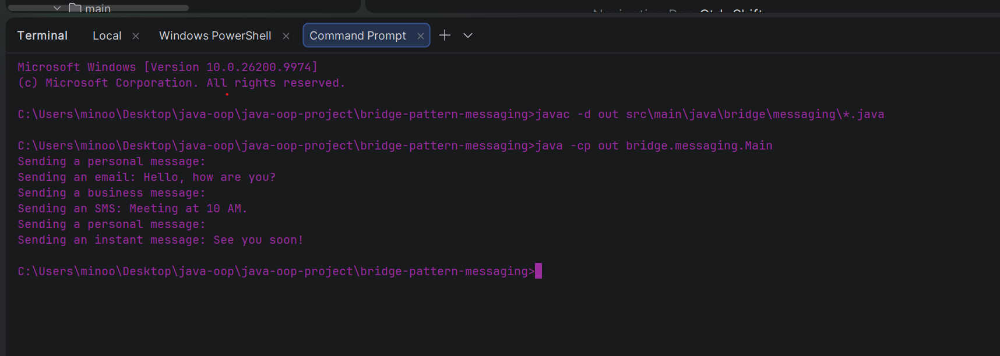
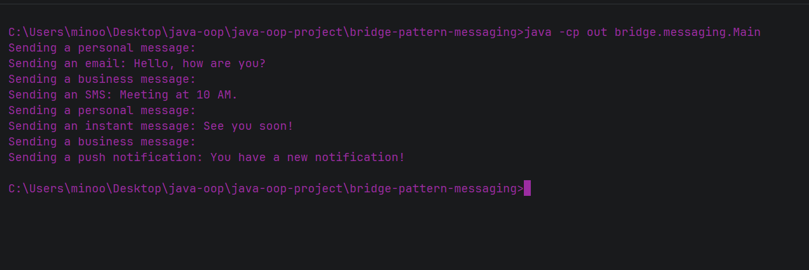

# Bridge Pattern - Messaging System

## Introduction

This is my Java project for the Bridge Design Pattern assignment.

The Bridge Pattern separates message types from the methods used to send messages. This makes the code easier to change and extend.

For this assignment, I used an existing messaging example and added a new feature to it.

## Original Project

I used the Messaging Bridge example from this GitHub repository:

https://github.com/vesavvo/design_patterns/tree/master/src/main/java/bridge/messaging

## Project Structure

The project has two message types:

- `PersonalMessage`
- `BusinessMessage`

Both classes extend the abstract `Message` class.

There is also an interface called `MessageImp` for sending messages.

The original sending methods are:

- `EmailImp`
- `SMSImp`
- `InstantMessageImp`

Each class implements the `MessageImp` interface.

## New Feature - Push Notification

I added a new class called `PushNotificationImp`.

This class implements the `MessageImp` interface and uses the `sendMessage()` method to display a push notification in the console.

I also updated `Main.java` to test the new feature with `BusinessMessage`.

The new feature works without changing the existing message classes.

## How to Run

I used Java and IntelliJ IDEA to work on this project.

First, open CMD in the project folder.

**1. Compile the project:**

```cmd
javac -d out src\main\java\bridge\messaging\*.java
```

**2. Run the project:**

```cmd
java -cp out bridge.messaging.Main
```

## Screenshots

### Screenshot 1 - Original Program

This screenshot shows the original messaging system working with Email, SMS, and Instant Message.



### Screenshot 2 - Program with Push Notification

This screenshot shows the program after adding the Push Notification feature.



## Testing

I tested the project using CMD.

First, I ran the original program to check that the three sending methods worked.

After adding `PushNotificationImp`, I compiled and ran the project again.

The program displayed the new push notification message:

```text
Sending a business message:
Sending a push notification: You have a new notification!
```

The original sending methods also worked correctly.

## Conclusion

In this project, I learned how the Bridge Design Pattern works in Java.

I added a new sending method without changing the main structure of the program.

This assignment helped me understand how the Bridge Pattern makes it easier to add new features to an existing project.


